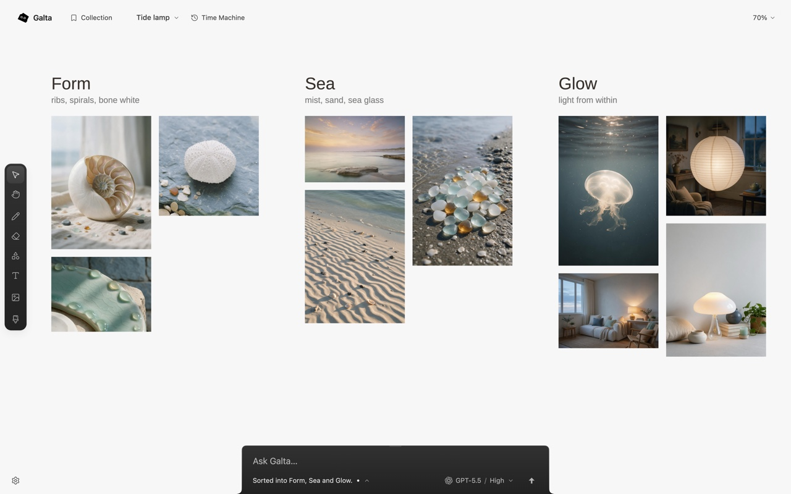

# Galta

Galta is a canvas that opens beside the web page you are browsing. Drag
references in, draw, point at what you mean, and ask. An agent reads the whole
canvas and the page you bound to it, then works on the canvas through Galta's
MCP tools.



- **Local first.** Each canvas is a project stored in your browser on your Mac.
  Drawing, importing and history work with no network and no agent.
- **Your own AI.** Chat in Galta with your ChatGPT account through the bundled
  Codex runtime, or work in Codex or Claude Code and watch the changes land on
  your canvas. Image, video and speech generation use your own BytePlus,
  OpenRouter, fal or Higgsfield account; the provider bills you directly and
  the key stays on your Mac.
- **Get it** at [galta.art](https://galta.art).

## Why the source is public

Galta is a browser extension that can capture and read the pages you bind to
a canvas, plus a Mac app that runs an agent on your machine. That is a lot of
trust to ask for. The code is here so you can check what it does against what
it promises in the [product contract](docs/blueprint.md).

This repository is published from Galta's development repository, one commit
per release. Its first commit is the development source of 2026-10-27, after
0.1.3 (build 30); from the next release on, each commit is the source that
release was built from.

## Contributing

Issues are welcome from everyone. Pull requests are accepted from members of
the Aha Labs organization; a bot closes others. See [CONTRIBUTING.md](CONTRIBUTING.md), and report security problems privately as
[SECURITY.md](SECURITY.md) describes.

## Building from source

You need [Bun](https://bun.sh) 1.3.14, Chrome or another Chromium browser, and
macOS for the native runtime.

```sh
bun install --frozen-lockfile
bun run test        # typecheck and unit tests
bun run build:dev   # the unpacked extension in apps/extension/dist
```

Load `apps/extension/dist` as an unpacked extension (`chrome://extensions`,
Developer mode, Load unpacked). The canvas works on its own. To connect an
agent without the Mac app, build and install the native hosts for your
extension's id:

```sh
bun run bridge:build
bun run canvas:install <extension-id>
bun run bridge:install <extension-id>
```

The installers copy the hosts into Galta's data directory; see
[native installation](native/adapters/codex/README.md).
`bun run test:browser` runs the Playwright suite; it needs Playwright's
Chromium (`bunx playwright install chromium`).

Builds are reproducible. A build is named by a digest of its sources (the
`data-build` attribute on Galta's page), and `bun run build` here writes the
same bytes to `apps/extension/release` as Galta's own build of the same
commit. A release build also sets `GALTA_COMPANION_URL` to the Mac app
download address it links to; set the same value to rebuild one.

## How it is built

| Path | What it is |
| --- | --- |
| `apps/extension` | The Manifest V3 extension: side panel, canvas page, offscreen host and content script |
| `packages/canvas` | The provider-neutral tool contract: tool names, schemas, effects and limits |
| `packages/domain`, `packages/storage`, `packages/capture` | Commits and history, IndexedDB storage, capture records |
| `packages/runtime` | The Codex app-server client |
| `native/` | Native hosts: the canvas bridge, the Codex adapter, the `galta-mcp` server, generation, and the Mac app's runtime |
| `plugins/galta` | The plugin that hands `galta-mcp` to external agents |
| `patches/` | Galta's patch to Excalidraw 0.18.1 |

The [architecture](docs/architecture.md), [agent architecture](docs/agent-architecture.md),
[agent and canvas contract](docs/design/agent-canvas-contract.md) and
[interface rules](docs/design/README.md) explain the rest.

## License

Galta is licensed under the [GNU Affero General Public License v3.0](LICENSE)
only. The license covers the code; it grants no rights to the Galta name or
logo. Galta builds on [Excalidraw](https://github.com/excalidraw/excalidraw);
[THIRD_PARTY_NOTICES.md](THIRD_PARTY_NOTICES.md) carries its notice and those
of the marks Galta shows.
