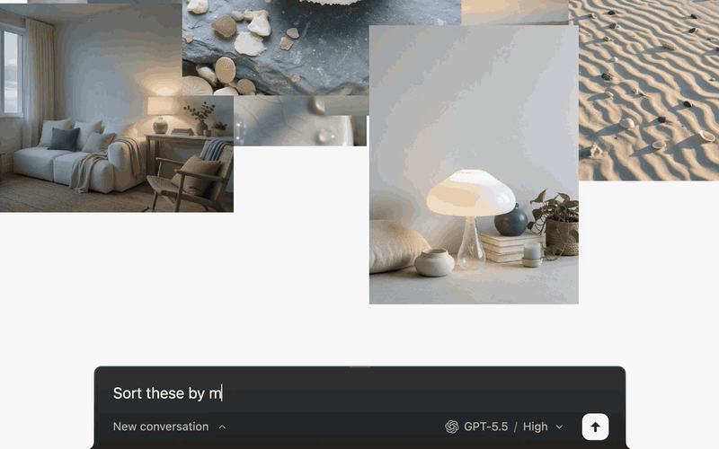

# Galta

**Point at what you mean. Work with an agent on the same canvas.**

Galta is a local-first AI canvas beside the web page you're browsing. Collect
references, sketch an idea, then ask Codex or Claude Code to work with what
you can both see. The result lands on your canvas.

[Get Galta](https://galta.art/download/?utm_source=github&utm_medium=readme&utm_campaign=public-launch) ·
[Explore the canvas](https://galta.art/en/?utm_source=github&utm_medium=readme&utm_campaign=public-launch#capture) ·
[中文](README.zh-CN.md)

[](https://galta.art/en/?utm_source=github&utm_medium=readme&utm_campaign=public-launch#capture)

*An eight-second interface walkthrough. Agent steps are re-enacted for the
demo; this is not a recording of live model reasoning.
[View the still](distribution/store/1-sort.jpg).*

## From references to something you can work on

- **Collect without losing the source.** Bring images and references from the
  page into the canvas, alongside your notes and drawings.
- **Point instead of explaining everything again.** Select an object or
  draw around a detail and ask for a change. The whole canvas remains context;
  your selection tells the agent where you're pointing.
- **Keep the work together.** Arrange a moodboard, explore a sketch, or make
  images, video and interactive HTML beside the material that informed them.
- **Return to an earlier idea.** Canvas history lets you revisit a previous
  state and continue from there.

For example, collect a few lamp references and ask: “Group these by shape,
material and light.” Then point at a sketch and ask: “Use this curve, keeping
the proportions of the lamp on the left.”

## Try it

1. [Install the browser extension and Mac app](https://galta.art/download/?utm_source=github&utm_medium=readme&utm_campaign=public-launch).
   The download page lists the current beta and device requirements.
2. Open Galta beside a page and bring in a few references. Drawing, importing
   and canvas history work without an agent or network connection.
3. Connect an agent in Settings. Chat in Galta with your ChatGPT account,
   or chat in Codex or Claude Code and watch the changes arrive on the canvas.

The native agent connection currently needs macOS. Image, video and speech
generation are optional and use your own connected provider account, billed
by that provider. An agent subscription does not include generation credits.

**Local storage, clear boundaries.** Canvases stay in your browser on your
Mac. When you ask a connected agent or generation provider to work, relevant
context is sent to that service; local storage does not mean local inference.
[Privacy](https://galta.art/privacy/) · [Help](https://galta.art/help/)

## Feedback and source

Trying it on a real project is the most useful way to help. If something gets
in the way, [open an issue](https://github.com/aha-labs-hq/galta/issues): say what
you wanted to make, what happened and which version you used. Share only
material you're comfortable making public. A star helps others discover Galta.

### Why the source is public

Galta is a browser extension that can capture and read the pages you bind to
a canvas, plus a Mac app that runs an agent on your machine. That is a lot of
trust to ask for. The code is here so you can check what it does against what
it promises in the [product contract](docs/blueprint.md).

Application source is published from Galta's development repository as release
snapshots. Documentation and presentation can be updated between releases.
The first snapshot is the development source of 2026-10-27, after 0.1.3
(build 30); later release snapshots contain the source those releases were
built from.

### Contributing

Issues are welcome from everyone. Pull requests are accepted from members of
the Aha Labs organization; a bot closes others. See [CONTRIBUTING.md](CONTRIBUTING.md), and report security problems privately as
[SECURITY.md](SECURITY.md) describes.

## Building from source

You need [Bun](https://bun.sh) 1.3.14, Chrome or another Chromium browser, and
macOS for the native runtime.

```sh
bun install --frozen-lockfile
bun run test        # typecheck and unit tests
bun run build:dev   # the unpacked extension in apps/extension/dist
```

Load `apps/extension/dist` as an unpacked extension (`chrome://extensions`,
Developer mode, Load unpacked). The canvas works on its own. To connect an
agent without the Mac app, build and install the native hosts for your
extension's id:

```sh
bun run bridge:build
bun run canvas:install <extension-id>
bun run bridge:install <extension-id>
```

The installers copy the hosts into Galta's data directory; see
[native installation](native/adapters/codex/README.md).
`bun run test:browser` runs the Playwright suite; it needs Playwright's
Chromium (`bunx playwright install chromium`).

Builds are reproducible. A build is named by a digest of its sources (the
`data-build` attribute on Galta's page), and `bun run build` here writes the
same bytes to `apps/extension/release` as Galta's own build of the same
commit. A release build also sets `GALTA_COMPANION_URL` to the Mac app
download address it links to; set the same value to rebuild one.

## How it is built

| Path | What it is |
| --- | --- |
| `apps/extension` | The Manifest V3 extension: side panel, canvas page, offscreen host and content script |
| `packages/canvas` | The provider-neutral tool contract: tool names, schemas, effects and limits |
| `packages/domain`, `packages/storage`, `packages/capture` | Commits and history, IndexedDB storage, capture records |
| `packages/runtime` | The Codex app-server client |
| `native/` | Native hosts: the canvas bridge, the Codex adapter, the `galta-mcp` server, generation, and the Mac app's runtime |
| `plugins/galta` | The plugin that hands `galta-mcp` to external agents |
| `patches/` | Galta's patch to Excalidraw 0.18.1 |

The [architecture](docs/architecture.md), [agent architecture](docs/agent-architecture.md),
[agent and canvas contract](docs/design/agent-canvas-contract.md) and
[interface rules](docs/design/README.md) explain the rest.

## License

Galta is licensed under the [GNU Affero General Public License v3.0](LICENSE)
only. The license covers the code; it grants no rights to the Galta name or
logo. Galta builds on [Excalidraw](https://github.com/excalidraw/excalidraw);
[THIRD_PARTY_NOTICES.md](THIRD_PARTY_NOTICES.md) carries its notice and those
of the marks Galta shows.
