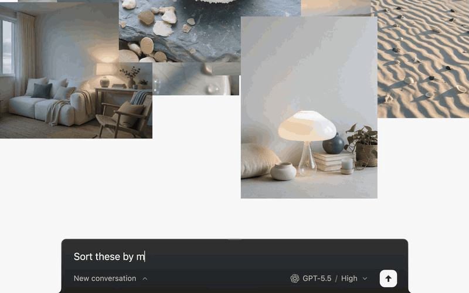

# Galta

**指给它看，在同一张画布上一起做。**

Galta 是打开在网页旁边的 AI 无限画布。把参考拖进来，画两笔，指出你想改的地方，
再让 Codex 或 Claude Code 接着做。参考、想法和结果都留在同一张画布上。

[安装 Galta](https://galta.art/zh-hans/download/?utm_source=github&utm_medium=readme&utm_campaign=public-launch) ·
[看看怎么用](https://galta.art/zh-hans/?utm_source=github&utm_medium=readme&utm_campaign=public-launch#capture) ·
[English](README.md)

*约八秒的界面演示。Agent 操作为演示重演，并非实时模型推理的录屏。
[查看静态截图](distribution/store/1-sort.jpg)。*

## 从参考开始，把想法接着做下去

- **收进来，也留住出处。** 网页里的图片与参考，和你的笔记、草图放在一起。
- **指清楚，再开口。** 选中对象，或圈出一个细节，再说你想怎么改。选中项是你指的地方，
  整张画布仍然是 Agent 理解任务的上下文。
- **结果回到原来的工作里。** 整理灵感板、探索草图，或生成图片、视频与交互 HTML，
  都可以放在参考旁边继续比较、修改。
- **回到之前的想法。** 从画布历史找到早先的状态，再从那里继续。

例如，收集几张灯具参考后说：“按形状、材质和光感分组。”
再指着草图说：“用这个弧度，保留左边那盏灯的比例。”

## 开始使用

1. [安装浏览器扩展和 Mac 应用](https://galta.art/zh-hans/download/?utm_source=github&utm_medium=readme&utm_campaign=public-launch)。
   当前测试版、设备和系统要求以下载页为准。
2. 在网页旁打开 Galta，拖入几张参考。绘画、导入和画布历史无需联网，也无需接入 Agent。
3. 在设置里连接 Agent。可以用自己的 ChatGPT 账号在 Galta 内聊天，
   也可以在 Codex 或 Claude Code 里交代任务，看结果落到画布上。

原生 Agent 连接目前需要 macOS。图片、视频与语音生成是可选能力，使用你自己接入的服务商账号，
由服务商计费；Agent 订阅不包含这些生成额度。

**画布存在本机，服务调用的边界讲清楚。** 画布保存在 Mac 的浏览器里；
请求 Agent 或生成服务工作时，相关上下文会发送给对应服务。本地存储不等于本地推理。
[隐私说明](https://galta.art/privacy/) · [使用帮助](https://galta.art/help/)

## 反馈与源码

拿一个真实项目试试，最能帮助 Galta 变好。如果哪里卡住了，
[告诉我们](https://github.com/aha-labs-hq/galta/issues)：你想做什么、实际发生了什么，以及使用的版本。
只分享你愿意公开的材料。如果这个方向对你有用，也欢迎 Star。

源码采用 [AGPL-3.0-only](LICENSE)，按发行版本从开发仓库发布；介绍和文档可以在两个版本之间更新。
Issue 向所有人开放，代码 PR 目前仅接受 Aha Labs 组织成员提交；
完整规则见 [贡献说明](CONTRIBUTING.md)。漏洞请按 [安全政策](SECURITY.md) 私下报告。

[从源码构建](README.md#building-from-source) ·
[架构](docs/architecture.md) · [Agent 与画布](docs/design/agent-canvas-contract.md)
