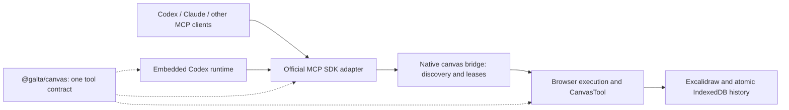

# Agent integration architecture

## Decision

Galta owns the canvas document, tool contract, artifact access and execution
leases. Agent hosts own reasoning, model selection, authentication and their
conversation lifecycle. MCP is the only live tool interface for both embedded
and external agents. Runtime adapters manage conversations, not canvas execution.
Plugins distribute the MCP entry point; they are not a second execution engine.



Codex threads register no dynamic Galta tools. Galta uses the official binary and
public app-server interfaces; it never repairs Codex rollout metadata or databases.
Legacy history stays intact, including accurate labels for past dynamic calls.
A fresh conversation obtains a fresh catalog when an old thread retains obsolete
declarations that the official API cannot remove. There is no retired-tool handler
or migration dependency in the runtime.
MCP also works independently of starting or authenticating Codex.

The [agent canvas contract](design/agent-canvas-contract.md) describes the
working experience: discover and search objects, read exact fields by stable
ID, apply atomic patches, and use precise errors and saved receipts to continue.
The interface borrows file-working habits while retaining native canvas
identity, grouping, selection and visual semantics.

## Ownership

| Concern | Single owner |
| --- | --- |
| Tool names, JSON schemas, effects, resource exclusion and content types | `@galta/canvas` |
| Canvas working contract: preservation, revision and artifact semantics | `@galta/canvas` |
| Durable artwork, conversation checkpoints and revision transactions | IndexedDB workspace repository |
| Interactive editing and viewport | Visible Excalidraw canvas |
| Embedded task lifetime, pending approvals and observer state | Extension offscreen task registry |
| Native geometry, revision checks and tool effects | Shared CanvasTool and ToolScene contract |
| Workspace files and local canvas discovery | Native Galta bridge |
| One active execution per document, immutable surface binding | Bridge lease registry, checked again by the browser |
| Submitted selection, viewport and selected source bytes | Browser submission boundary |
| Bounded message observation and pixels | Task host using CanvasTool against the submitted snapshot |
| Changes since the previous submitted observation | Saved canvas ancestry and conversation turn receipts |
| Source-page tab binding, DOM refs, pixels and interactions | Extension source-page port and isolated content script |
| MCP lifecycle, protocol errors, tool content conversion | MCP adapter using the official SDK |
| Reasoning, model retries and authoritative thread/turn lifecycle | Codex app-server |
| Codex event projection and host interaction cancellation | Codex runtime adapter |
| Shared Codex transport, RPC routing and task-to-turn ownership | Extension Codex adapter |
| Generation tools, providers and settings messages | `@galta/canvas` (`media.ts`) |
| Provider keys, generation jobs and their files | `native/media`, inside the MCP process; keys written only by the companion's `media/settings` |
| Conversation and canvas history | Galta storage; provider checkpoint IDs remain opaque |

## Instruction boundaries

Only two instruction texts reach an agent, besides the tool descriptions. MCP
delivers the short `GALTA_MCP_INSTRUCTIONS` (`packages/canvas/src/instructions.ts`)
to embedded and external agents, and the embedded turn uses `codexInstructions`,
including the shared selection routing and coordinate semantics, without
replacing Codex's base prompt.
Keeping the canvas working (`CANVAS_WORKING_INSTRUCTIONS`: reserve places before
slow work and fill each as soon as it exists) is in both live channels, because a
Code Mode agent sees tool names, not descriptions, until it loads one. A live run
on 2026-10-13 without it left the canvas idle and placed three variants at once;
with it, the agent reserved three places, then filled them one by one. The host
guidance also prefers a galta tool over a skill that does the same work, so a
connected provider is used before Codex's own image skill.
The MCP introduction keeps binding, preservation and the core
workflow self-contained within 512 characters, following the official
[MCP guidance](https://learn.chatgpt.com/docs/extend/mcp?surface=cli).
HTML creation, update,
resource and preview constraints belong to the shared `canvas_edit` description,
not to a private Codex prompt. The canvas instructions name no reasoning model,
generation provider, output language, personal filesystem path or approval policy.

Spatial observations use editor-computed world `bounds`; native `x/y` retain their
editing meaning and are not projected as bounding-box origins. The schema and
coordinate explanation belong to `packages/canvas/src/bounds.ts`, and the browser
projection belongs to `canvas/observation.ts`. Message summaries reuse the inspect
projection. No shape classifier, path-summary cache or alternative renderer is
introduced. See the 2026-09-26 causal audit
for the demonstrated input mismatch and the limits of the model experiment.

The shared canvas contract asks agents to create editable units according to what
users would select, move or reuse together, and verify grouping alongside content.
Native `groupIds` are the only grouping authority; nested groups express useful
subunits, while independent work remains separate. Default `canvas_inspect` reads
and `canvas_edit` receipts share the same projection, including nonempty
`groupIds` in innermost-first order. Omission means ungrouped in these summaries;
detailed reads retain explicit empty arrays. Grouping is chosen by the agent for
the task, never inferred from element count or tool-batch boundaries.

That requirement reaches an agent through the tool surface and the MCP
instructions: `canvas_edit`'s
description and the `groupIds` field carry it in the tool channel, and
`GALTA_MCP_INSTRUCTIONS` carries it in the first 512 characters. The engine never
assigns group ids itself, so compliance remains the agent's judgement rather than
an implemented guarantee. Guidance names sharing one group id directly on all
members, because `relatedElementIds` expands a grouped move by one level only
(`apps/extension/src/canvas/relationships.ts`); membership expressed purely
through nesting would not drag as one unit.

The Codex adapter owns its host-specific execution and conversation guidance.
It follows the current user's language unless another language is requested.
User text and its canvas observation are delivered as user-message content;
application instructions and execution binding stay on their own channel.
Canvas content and web captures are untrusted data.
Each turn includes the bound source-page context (or a concrete unavailable
reason). Historical imported URLs are not submitted as current-page references.
Canvas submission freezes a saved document, selection and viewport.
`prepareCanvasMessage` reuses the tool projection and renderer to attach bounded
observation metadata and a viewport image to each message, even when nothing is
selected. The viewport image is the only pixel input. When the latest observed
turn in the same Codex thread saw the same commit and viewport, and no context
compaction has happened since, the message names that earlier preview as
`unchanged` instead of resending it. A small durable receipt ties each
observation to its commit, viewport, preview evidence and actual Codex turn; the
preceding receipt in this conversation provides the change baseline. Saved ancestry supplies net differences and their
recorded sources. There is no second history or inferred-intent classifier.
The shared Zod message schema owns the fields and limits; see the
[message contract](design/agent-canvas-contract.md#user-messages-and-canvas-observations).
Frozen identities stay in the execution's submitted state. `canvas_inspect` reads
canvas, selection, viewport or changes pages with coverage and a
revision for continuation; missing submitted objects remain explicit. Change
history must have been supplied by the conversation host. UI selection belongs
to the editor; tools label it `selectedAtSubmission` instead of claiming live
selection or intended edits. It never repeats all selected IDs in each result. Small canvases still fit in one default read. Detailed fields
are opt-in and may be large for an individual object; pagination does not promise
a model-independent token cap.
The agent is told it operates inside a browser extension, usually beside an
independently navigable webpage. Page context is a submission-time observation,
not a live feed. Same-tab navigation requires a fresh read and invalidates old
refs; switching tabs never retargets a running task. Page changes do not cancel
independent canvas work, change the user's goal or authorize new actions.
The agent interprets selection, visual context and changes together with the
user's words. Observations do not prescribe a task or an edit target. Ordinary
conversation needs no additional tool reads unless its answer depends on them.
Native brush/editable-element requests retain their medium; raster resemblance
alone is insufficient. `canvas_inspect.viewport` and its viewport scope use the
submitted view bounds. They are not a live UI observation.
Webpage text comes from top-document DOM blocks intersecting the viewport;
clipping, occlusion, nested frames and shadow roots are not resolved. Text has
one aggregate 16,000-character budget without a silent per-node cutoff. Clipped
labels and options carry explicit flags (and total option count); oversized
image URLs are omitted with a reason rather than returned as invalid prefixes.
Any such omission sets `truncated`. Complete page or pixel claims require the
appropriate additional evidence, not merely a successful DOM read.
The source-page contract is shared in `packages/canvas/src/browser.ts`;
`browser_inspect`, `browser_capture` and `browser_act` are served by the same MCP adapter.
External clients use their connected canvas. Embedded Codex starts the same full
`galta` MCP server, with no mode flags. The task host owns the composite execution ID
in trusted application context; the MCP adapter binds calls to the unique active
UI-owned lease without asking the model to copy that ID. A legacy ID remains
accepted and is removed before dispatch. Each call borrows the current host-owned
lease without acquiring or releasing it. The registry checks its lifetime and the
browser checks revision, persistence and Stop. Source-page content remains
untrusted and never owns an execution identity.
No global Codex config is edited and existing conversations are not replaced.
The adapter does not replace Codex's base instructions or collaboration modes.
The canvas bridge alone allocates the execution workspace. The Codex adapter
uses the bound execution's `cwd`; its `galta/config/read` request only reads local
runtime configuration and cannot create a second workspace. Canvas schemas,
operations and artifact interfaces are imported directly from `@galta/canvas`,
without compatibility exports through the agent runtime.

## Capabilities

The canvas is Galta's core. A capability is a producer the agent calls on
through the same `galta` MCP server: it makes files or data and never changes
a canvas, so canvas tools stay the only way work reaches the document. A
capability plugs in through `native/mcp/capability.ts`:

- **Listed only while usable.** `tools()` returns nothing while the capability
  cannot be used, so it costs no tokens. When availability changes, the
  server sends `notifications/tools/list_changed`; built-in chat reconnects
  when idle after a Generation change in Settings, since Codex fixes its tool list per
  connection.
- **Progressive disclosure and caching.** Always-sent text stays short and
  byte-stable between availability changes: global instructions name no
  capability, each tool has a one-line description and lean schema, and the
  detail arrives on demand in tool results. The tool fingerprint covers every
  capability's full contract, whatever is listed.
- **Files land where the canvas can use them.** A call that writes files (the
  capability's `writesFiles`) goes to the bound execution's workspace: an
  embedded call names its execution and the bridge's `execution/workspace`
  returns that lease's workspace; an external client uses the canvas it
  connected. `canvas_capture` with `file` saves the exact view as a reference
  for a capability, so a sketch, a layout or marks over an image can be used.
- **Work shows on the canvas while it happens.** Before slow work, the agent
  holds the place where each result will land (`canvas_reserve`, sized to the
  result's proportions). A held place carries the agent's working light, the
  same light and pace as the dock's (`agentLight.tsx`). An edit fills it through
  `slot`: `canvas_place` for media, `canvas_edit` for a page, a frame or any
  element with a box. The element takes the place's box, media fitted in its
  own proportions, and the place ends when the edit commits. Places are view
  state, never document state: no revision, history or export. They live with
  the execution's `CanvasTool`; an embedded task publishes them in its task
  state and an external execution shows them on the live view, and they end
  when filled, released, or when the execution ends.

### Generation

Images, video and speech come from the provider account the user connects
under Generation in Settings (BytePlus, OpenRouter, fal or Higgsfield); the
provider bills the user directly. Tools are `generation_models`,
`generate_image`, `generate_video`, `generate_speech` (listed only when a
connected provider speaks), `generation_get` and `generation_list`. Files go
to the workspace `outputs`, or to `<data root>/media/files` when nothing is
bound.

- **On demand.** `generation_models` asks only connected providers, says what
  each model is best at (`native/media/notes.ts`), and for a given kind adds
  the craft guide (`native/media/guide.ts`): work from what the user made,
  give each reference a role, anchor video on a placed key image, and place
  results as they arrive. Finished images come back as pictures only with
  `generation_get` `preview: true`; looking at them on the canvas costs less.
- **Keys.** Settings sends a key through the companion's `media/settings`.
  It is stored only after the provider accepts it on a free read-only request,
  in `<data root>/media/keys.json` (0600 in a 0700 directory), and read per
  call. No answer, tool, log or export carries it.
- **Paying once.** Every new generation carries a new `requestId`; a reused id
  with a different request is refused. A submission whose answer was lost is
  `interrupted` and never resent. A 4xx is a plain failure that charged
  nothing.
- **Nothing paid for is lost.** The paid submission runs in a detached worker,
  the same executable started again in its own session (`native/launch.ts`
  records how). It claims the job, sends it once, and carries it until its
  files are saved, a video through its task and download too. The agent host
  closing or killing the MCP process, as it does when a panel closes or the
  extension reloads, cannot reach it. A Stop does not cancel it either; the
  tools tell the agent to look at `generation_list` before generating again.
- **Waiting.** A wait ends when its call is cancelled and never outlasts what
  the caller allows: Galta registers its embedded server with a 180 s tool
  timeout, so a wait there may last 110 s (a video takes minutes, so the agent
  waits long rather than often); other clients get at most 50 s.
- **Resuming.** Jobs live in `<data root>/media/jobs.sqlite`, shared by every
  MCP process of the user. A process owns a job only while it talks to the
  provider (an owner pid and a version check), so another process can finish
  polling or a failed download without paying again.
- **Checking before paying.** Controls are checked against the model before
  submission: BytePlus against the models the adapter knows, OpenRouter against
  what its catalogue documents. What the catalogue does not describe is left to
  the provider, whose refusal charges nothing. fal and Higgsfield publish each
  model's input as JSON Schema (fal in each endpoint's OpenAPI, read when the
  model is used; Higgsfield in its API docs, copied by
  `scripts/higgsfield-models.ts`), so `native/media/providers/endpoint.ts` maps
  Galta's controls onto the model's own fields and refuses a control it lacks,
  a value it does not allow, or a requirement left unfilled. On these two each
  task is its own model id (text-to-video, image-to-video, edit). With no
  provider named, the first connected provider that makes the kind is used.
- **Queues and uploads.** fal and Higgsfield queue every request, so an image
  too resumes from its task. fal's fallback to "equivalent" models is turned
  off: the model named is the model used. Higgsfield reads inputs only from
  public HTTPS addresses, so local references go to its file storage as the
  paid request is sent, never when it is prepared; a retried requestId keeps
  its fingerprint, and a failed upload ends the job with nothing sent.

## Local topology

The extension starts `com.galta.canvas` and registers each open canvas explicitly.
Choosing built-in chat in Connection details separately starts `com.galta.codex`, which owns the
app-server process. Embedded tasks register their own offscreen canvas endpoints;
closing their visible panels leaves those endpoints and native clients alive.
Closing all endpoints closes the canvas host. This
separation makes a canvas available without a Codex installation or account.
The canvas host exposes a loopback-only authenticated service and writes a mode-0600
discovery descriptor in a mode-0700 directory. The MCP stdio process discovers
live bridges; it neither starts Codex nor scans browser storage.

An MCP client lists canvases and connects to an explicit canvas ID. Connection
acquires one execution lease and captures selection and viewport. A lease
never follows focus, a different tab or a replacement surface. Another external
writer for the same project within this browser's extension host is refused;
independent embedded task leases may coexist and the bridge still serializes
canvas mutations. Separate
browser profiles have separate document stores and separate bridges. Tools operate on this bound lease until release,
Stop, transport close or canvas close. Read-only clients can inspect the list
without acquiring a document. No remote listener or public tunnel is introduced.

Embedded runs and MCP runs share browser exclusion and the same CanvasTool
implementation. The browser remains the final authority for live revision,
pending user/import changes and durable mutation. A successful tool response
means persistence and application completed; losing a response never triggers a
mutation retry. Cancellation preserves earlier committed edits. For a visible
external MCP surface, a candidate saved
before cancellation but not yet applied remains recoverable in history; it does
not replace the current canvas. Late responses cannot revive a released lease.
Tool definitions own both MCP approval hints and resource exclusion, which are
different concerns. Independent canvas observations and exports may overlap;
canvas mutations are exclusive on the canvas. Export creates a new file and is
therefore not advertised as read-only, but does not mutate the canvas. Webpage
calls are serialized because reads replace snapshot refs, and can overlap
independent canvas work. The bridge enforces this contract without queuing or
replaying rejected operations; the task host does not add another tool lock.
For embedded tasks, the offscreen document owns orchestration, source binding,
tool execution, pending approvals and final transcript persistence. A view is an
observer using BroadcastChannel commands and complete versioned task projections.
Projections are immutable before publication: unchanged output strings are shared
until the latest 50ms display batch is serialized. Questions, errors and terminal
states publish immediately. The view's conversation subscription reconciles
unchanged item identities; streaming text does not update the workspace root.
`agentMessage.phase` is retained across live and restored items so the reading
surface can distinguish commentary from provider-identified responses without
guessing from message order. See the [reading contract](design/conversation-reading.md).
Blob references cross this channel by structured clone; Chrome runtime messages
only ensure the singleton host exists. Observer closure never releases a lease.
Explicit Stop aborts preparation and tools, interrupts Codex once, and waits for
the matching `turn/completed`, terminal persistence and lease cleanup. Neither an
`error` notification nor a `turn/interrupt` acknowledgement ends the runtime
iterator; final item receipts remain observable. A completion already received
wins a late Stop. Connection loss remains a terminal failure.
`serverRequest/resolved` dismisses pending host interaction immediately, including
requests queued behind persistence. Turn completion and transport loss also
close pending prompts; a cleared request receives no stale answer.
The shared transport keeps one ownership record per active thread, with its turn
ID and closing state. Completion for another turn cannot release that record.
If a detached task's interrupt fails while its turn is still owned, the bridge
closes the actual transport and fails all affected tasks explicitly; it never
announces a disconnection while leaving the orphan running. A rejection arriving
after that turn completed is harmless.
Delayed controls carry task/question IDs
and cannot affect replacement work. No automatic mutation retry is introduced.
Background edits select a durable version atomically; Stop after commit cannot
roll it back. The visible editor applies committed results with its own camera
and undo history, or preserves local edits and offers the external version.
External MCP connections retain the existing staged/apply/activate behavior and
remain tied to the selected visible surface.

Browser dispatch is bounded to 60 seconds; client requests close their transport
after 65 seconds. Disconnection rejects pending requests, cancels browser work
and reports failed cleanup. A replacement port never receives an old result.
Disconnect cleanup failures include the bridge and lease IDs on the native
host's stderr. A client cannot manage an external connection while its UI-owned
tool calls are pending, including while those calls discover the bridge.
Cancelling connection acquisition closes that client's bridge socket: a lease
may already exist while its acknowledgement is in transit, so its owner must
end even when the client has not received the lease ID. Cancelling an ordinary
tool call preserves the connection. Embedded submissions freeze both structured
context and the selected source bytes before awaiting the document lease.

Artifacts are accessed through a narrow interface. Canvas code does not know
Codex RPC method names, thread IDs or approval policy. The native boundary checks
real paths and file types; MCP cannot write arbitrary filesystem paths. Export
uses unique source filenames and exclusive publication, preserving original
bytes. Artifact operations are bounded to the selected creative workspace.

## Compatibility and scope

Agent independence means different agent clients can operate the same document
through the same contract. It does not imply portable hidden reasoning or that
every runtime supports forks. Runtime capabilities are explicit. Existing canvas
snapshots and Codex histories are preserved; storage normalization upgrades old
`codexSessions` and `codexCheckpoints` fields to `agentSessions` and
`agentCheckpoints` at the repository/import boundary. Checkpoints retain the
`codex-app-server` provider tag. Conflicting old and new histories fail visibly.
External conversations remain in their host; Galta records execution provenance
on canvas versions. MCP does not implement a second conversation runtime or
promise portable forks. `AgentRuntime` exposes capabilities; native Codex input
and update types own its thread and turn identifiers.

Canvas and webpage views return MCP image blocks. The former dynamic-tool image
routing override is removed. Model-visible pixel acceptance must pass on the MCP
path, including a continued legacy conversation. Cache or latency improvements
require measurements, not deductions from adopting MCP.

## Codex boundary

Galta's public connection and installed runtime are agent neutral. Galta MCP is
the shared canvas boundary for embedded and external agents. The optional
built-in chat uses the Codex-specific adapter in `native/adapters/codex` and the
extension's `NativeCodexAdapter`; its protocol and account remain owned by Codex.
The registered `com.galta.codex` host and `galta-codex-bridge` executable retain
their installed transport identities. They do not name the shared connection
capability or imply that external agents run through Codex.

The official [app-server guide](https://learn.chatgpt.com/docs/app-server)
describes rich product integrations and a default local Code Mode host. Galta
ships the complete matching Codex package and lets app-server own that host,
tool routing, subprocesses and retries. Production does not force code mode or
direct-only routing; the packaging fixture enables code-mode-only execution to
verify the dependency. Successful packaging is not a latency benchmark.

`experimentalApi` remains enabled because the bundled 0.162.0-alpha.17.2 protocol
gates `turn/start.additionalContext`; `thread/fork.lastTurnId` is in the stable
schema. This is distinct from `features.code_mode`. Validate fields against
schemas generated by the
bundled binary when upgrading. No second scheduler or model-retry loop belongs
in this adapter. Provider retry events are projected into conversation activity
with their actual diagnostics; a completed tool alone does not signal that the
model connection recovered. The adapter gives a retry stream at most 30 seconds
without model progress, and gives a terminal error 2 seconds for final item
receipts before recording a failure. These bounds release an orphaned UI state;
they do not retry the provider or replay a turn.

The hosted-agent target is installation of the browser extension followed by
login, with no native host, CLI, MCP configuration or user-supplied API key.
That deployment is not implemented here. It requires the extension's own
authenticated outbound connection, remote execution routing and transferable
artifact references. The local Codex/native-host path remains an optional local
mode, not a prerequisite for the future hosted mode.

## Installation and use

Galta for Mac owns packaged installations. Update the complete app and choose
**Connect browser**; its registrations, launcher and MCP must all resolve through
the selected immutable release. See [distribution](distribution.md).

For a standalone developer installation without the Mac app, build the extension
and native binaries, then install both hosts for the unpacked extension's actual ID.
These installers refuse to replace a Mac app installation or its repair state:

```sh
bun install --frozen-lockfile
bun run build:dev
bun run bridge:build
bun run canvas:install <extension-id>
bun run bridge:install <extension-id>
```

Galta keeps private runtime state under the platform's native application-data
directory:

| Platform | Managed data root |
| --- | --- |
| macOS | `~/Library/Application Support/Galta` |
| Windows | `%LOCALAPPDATA%\\Galta` |
| Linux | `${XDG_DATA_HOME:-~/.local/share}/galta` |

The standalone installers copy all three executables to the root's `bin` directory; browser
manifests point to these installed copies, never the checkout. Re-run both
installers after rebuilding native code, then reload the extension and open a
canvas. This keeps normal startup outside macOS-protected source directories.
Codex app-server starts in the root's private `runtime` directory, with
individual turns scoped to `workspaces/<project-hash>`. Internal source and
output artifacts stay there; user-owned files leave Galta only through an
explicit export. Its process configuration disables inherited
external completion notifications (`notify=[]`); Galta owns completion UI.
Command execution defaults to full access without approvals and connected app
tools default to `approve`. These settings are checked on connection and do not
edit the user's global Codex configuration or other clients' MCP policy.
Actual access to protected user files still
requires macOS consent; see [native installation](../native/adapters/codex/README.md).

Configure an MCP client with the absolute path supplied by the Mac app's connection
details, or printed by `canvas:install` for standalone development (stdio; no
arguments). For standalone development on macOS, Claude Code accepts this
`.mcp.json` shape:

```json
{
  "mcpServers": {
    "galta": { "command": "/Users/you/Library/Application Support/Galta/bin/galta-mcp", "args": [] }
  }
}
```

Codex accepts the same executable in its normal MCP configuration:

```toml
[mcp_servers.galta]
command = "/Users/you/Library/Application Support/Galta/bin/galta-mcp"
```

Clients own tool approvals. Codex read-only mode can refuse canvas writes;
`approval_policy = "never"` alone does not approve MCP writes. When the user
authorizes all Galta actions, set this server's
`default_tools_approval_mode = "approve"`. Galta does not edit global agent
configuration. The packaged plugin in `plugins/galta` resolves the managed MCP
path directly, preferring the Mac app's active release with a fallback to the
developer install. No PATH edit is needed. The Mac app can also copy the correct
absolute configuration for other clients. See [distribution](distribution.md). The plugin
adds only the MCP entry and product metadata. No global skill or marketplace is
required. Prefer product-specific skill triggers if other installed skills also
claim generic canvas requests.

`canvas_list` returns explicit composite IDs (`bridge/surface`) and busy state;
`canvas_connect` reserves that target and returns its canvas ID and artifact
workspace. Its lease stays private to the MCP connection; external calls omit
`executionId`. Embedded calls require the exact `execution.id` supplied in the
current turn's application context. Their MCP schemas expose that required
binding and omit client connection-management tools. Missing and released IDs
fail without searching for another execution, so concurrent browser tasks cannot
borrow one another's leases. The tool-contract fingerprint includes these
embedded schemas; upgrading the extension requires the matching local runtime.
`canvas_inspect`, `canvas_capture`, `canvas_report`, `canvas_edit`, `canvas_place`, `canvas_reserve`,
`canvas_extract` and `canvas_deliver`
share the same operation schemas and implementation as the embedded adapter;
only embedded calls add the required execution binding.
The three `browser_*` tools operate on the source page bound by that execution.
`canvas_disconnect`, the visible Stop control, and client disconnection release
the execution. A released connection must connect explicitly again.

Discovery defaults to the managed root's `bridges` directory. Descriptors contain a local
credential and must stay private. The host accepts loopback connections with
that credential and rejects browser Origin headers. It grants access to local
processes running as the same OS user, not remote or web-page callers. Invalid
descriptor permissions fail explicitly; dead endpoints from killed hosts and a
descriptor still being written are ignored. A bound call opens only its own
bridge's descriptor, so another browser's bridge never affects it. A live bridge
built with other tools, such as one in a browser that has not reloaded Galta
after an update, is left out of `canvas_list`, which reports the omission and
its fix in a second text block beside the array; with nothing else open, that
fix is the error. `GALTA_BRIDGE_DIRECTORY` and `GALTA_WORKSPACE_DIRECTORY`
isolate tests.

An open canvas keeps one target ID. When its registration is lost, because
Galta for Mac was not connected yet or its native host exited, it registers again
under that ID the next time it is shown or Settings checks the connection, and
Settings reports a registration that fails. Nothing reconnects an execution: a
lease the disconnect ended stays ended, and an agent connects explicitly again.
Development installation is verified on macOS; signed cross-platform
distribution is a separate release concern.

On macOS, upgrading from builds that used `~/.local/share/galta` performs one
atomic move to Application Support. Installation refuses to migrate while an
old bridge is alive or when both roots contain data; it never merges or
overwrites workspaces. Stale bridge descriptors are discarded. Artifact paths
stored by older canvases are resolved against the same project workspace after
the move. Linux performs the equivalent migration when adopting a custom
`XDG_DATA_HOME`. Windows uses `LOCALAPPDATA` from the first release that supports
its native host; Windows native-host installation itself remains a separate
distribution milestone.

## Verification commands

```sh
bun run test
bun run test:browser
bun scripts/verify-canvas-mcp.ts
bun scripts/verify-mcp-models.ts
bun scripts/verify-codex-ui-live.ts
bun scripts/verify-native-mcp.ts
bun scripts/verify-input-context.ts
bun scripts/verify-conversation-metadata.ts
bun scripts/verify-unified-mcp.ts
bun scripts/verify-background-tasks.ts
```

The first live script uses the official MCP client and the real native host,
production browser page and IndexedDB with only Chrome message delivery adapted.
The second makes real Codex and Claude calls against isolated canvases, with
random raster-only identifiers; it consumes provider allowance. The third
checks embedded Codex session continuation and interruption. Native installed
extension acceptance is distinct from localhost production-page evidence: the
fourth live script loads the release extension and registers its real native
host inside a disposable Chrome profile. Set `GALTA_EXTENSION_CHROME_PATH` to an
extension-capable Chrome executable for that script and the packaged HTML test.
The input-context and metadata checks run the official Codex binary against a
local Responses fixture in an isolated home, verifying the actual catalog,
compact orientation, native context deduplication, and naming isolation without
paid inference. The unified MCP check uses the real model and extension to continue
a thread through a browser restart, a webpage task and a canvas media task using
public interfaces only.

The 2026-09-18 acceptance report
records protocol, browser, native-extension and real-model evidence separately.
The independent review
records subsequent fixes for submission-preview and connection-cancellation races.

## Acceptance

1. Neutral canvas package builds without Codex or MCP SDK dependencies.
2. Existing canvas semantics, atomic rejection, frozen references and persistence
   tests pass through the neutral implementation.
3. Real MCP SDK clients discover, connect, render and mutate an isolated browser
   canvas. Wrong target, concurrent owner, stale revision, cancellation, closed
   canvas and disconnected client fail explicitly without late writes.
4. Codex and a second available agent recognize random raster-only content and
   use the same MCP tools; receipts distinguish real model runs from protocol tests.
5. Embedded Codex creation, continuation, interruption and old registrations
   remain functional. Existing histories survive storage normalization.
6. Plugin packaging validates and documentation names startup, shutdown, local
   access boundaries and unsupported runtime features.
